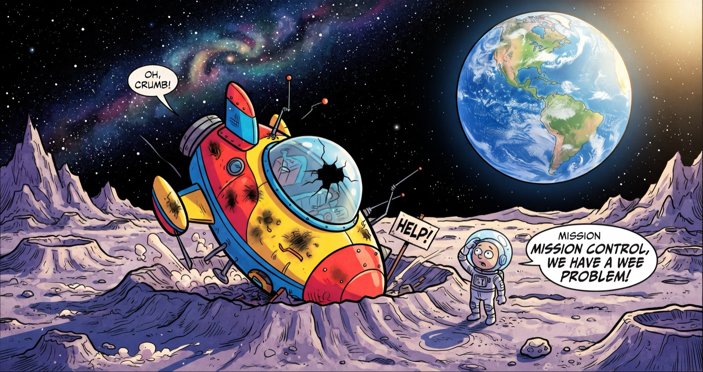

<p align="center">
  
</p>

# Moon Survival

A team-building web app based on the NASA Moon Survival exercise. You've crash-landed on the moon and must reach the mother ship 200 miles away. Rank 15 salvaged items from most to least important for survival, first alone, then as a team, and compare both rankings with NASA's expert answers. Lower scores are better.

## How it works

1. A facilitator logs in to the password-protected admin dashboard, creates a **session** with its teams, and shares the link.
2. Each person joins the session, picks a team, and ranks the 15 items on their own. This individual ranking is locked in and final.
3. The team discusses and agrees on one ranking. The first teammate to lock it submits for the whole team.
4. Both rankings are scored against NASA's ranking, and the reasoning behind each item is revealed.
5. The admin dashboard updates live with final scores, and past sessions are kept as history.

You can also play alone with no session at `/play/individual` ("Try it on your own" on the landing page). Solo mode keeps everything in `localStorage` and never touches the server.

### Scoring

Each item's score is the absolute difference between your rank and NASA's rank, summed across all 15 items. The maximum is 112.

| Score  | Band                                           |
| ------ | ---------------------------------------------- |
| 0–25   | Excellent                                      |
| 26–32  | Good                                           |
| 33–45  | Average                                        |
| 46–55  | Fair                                           |
| 56–70  | Poor (Earth-bound logic)                       |
| 71–112 | Very poor (casualties of the space program)    |

Scores are computed on the server only; clients send orders, never scores.

## Tech stack

- [TanStack Start](https://tanstack.com/start) + TanStack Router, React 19
- Tailwind CSS v4, shadcn/ui, `motion`
- Cloudflare Workers, with **D1** as the source of truth and one **Durable Object** per session for WebSocket live updates

## Getting started

```bash
npm install
cp .dev.vars.example .dev.vars   # set ADMIN_PASSWORD
npm run db:migrate               # apply migrations to the local D1
npm run dev                      # http://localhost:3000
```

The admin dashboard is at `/admin/login`.

## Scripts

| Command                     | Description                                      |
| --------------------------- | ------------------------------------------------ |
| `npm run dev`               | Start the dev server                             |
| `npm run build`             | Production build                                 |
| `npm run lint`              | ESLint                                           |
| `npm run check`             | Prettier check                                   |
| `npm run db:migrate`        | Apply `migrations/` to the local D1              |
| `npm run db:migrate:remote` | Apply `migrations/` to the production D1         |
| `npm run cf-typegen`        | Regenerate `worker-configuration.d.ts`           |
| `npm run deploy`            | Build and deploy with wrangler                   |

## Deploying

```bash
npx wrangler d1 create moon-survival     # paste the database_id into wrangler.jsonc
npm run db:migrate:remote
npx wrangler secret put ADMIN_PASSWORD
npm run deploy
```

## Project layout

- `src/lib/nasa.ts`: the 15 items, NASA's ranks and reasoning, scoring and score bands
- `src/routes/`: file-based routes (landing, join, rounds, solo mode, admin)
- `src/server/`: Durable Object, D1 helpers, admin auth and server functions
- `src/components/challenge/`: ranking list, results and round UI
- `src/components/admin/`: live dashboard and score chart
- `migrations/`: D1 schema
